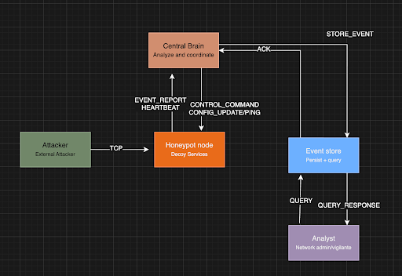
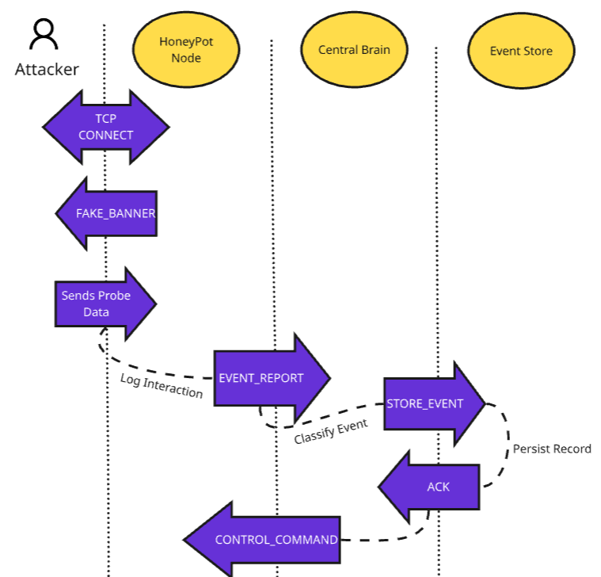
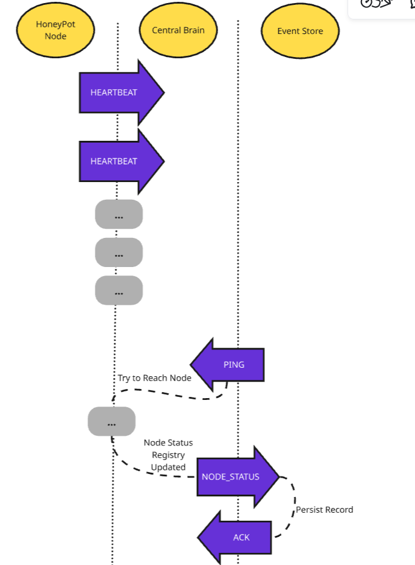

# **Proposal for the Honeypot Detection Protocol (HDP)**

By Anthony Covello, Francis Dinh, Eli Gold 

## **Problem Description**

Cyberattacks are a growing problem for institutions that manage sensitive data, and the tools used to defend against them have not always kept pace. Platforms that millions of people rely on have been breached in recent years, and in many cases the attack went undetected until significant damage was done. Simply watching network logs is no longer enough. Administrators need systems that actively draw out attackers and gather intelligence on them in real time. Our project builds exactly that: a distributed honeypot system that uses decoy network nodes to simulate vulnerable services, lure in suspicious actors, and capture their behavior for analysis. The system is governed by a custom communication protocol we designed called HDP, the Honeypot Detection Protocol. When an attacker connects to one of the honeypot nodes, the system records the interaction, classifies the type of attack, and responds adaptively. The target users are network administrators and security teams at organizations that handle sensitive data, such as universities, hospitals, and enterprise networks. As a concrete example: an attacker scanning a university network finds what looks like an exposed SSH service and starts trying common username and password combinations. The honeypot captures every attempt, reports it to the Central Brain, which identifies it as a brute force attack and tells the honeypot to slow its responses down, keeping the attacker occupied while the administrator gets alerted.

A single honeypot cannot provide adequate coverage or analytical depth for a real network environment. Distributing honeypot nodes across a network makes the decoys blend into what appears to be legitimate infrastructure, increasing the likelihood that automated scanners and targeted attackers will interact with them. More importantly, when multiple honeypot nodes simultaneously observe high volumes of connection attempts from the same IP range, or detect patterns of incomplete TCP handshakes across ports, the Central Brain can identify this as a coordinated attack such as a DDoS or port sweep that no single node would recognize in isolation. A single monolithic application would require all detection logic to run in one process, creating a single point of failure and limiting visibility to one network location.

The HDP is designed exclusively for internal communication between honeypot nodes and the Central Brain and is not exposed to the network being monitored. Every node must authenticate with the Central Brain at startup to prevent the protocol from being discovered and hijacked by an attacker. The system is also intentionally lightweight in its coordination overhead, since honeypot nodes must dedicate most of their capacity to faithfully simulating services and capturing interactions. These constraints reflect the reality that this system will be deployed inside networks that are actively targeted, where both stealth and reliability matter.

##    		 **System Architecture Overview**

The system is composed of three independently running components that communicate exclusively over TCP using the Honeypot Detection Protocol (HDP), a custom JSON-based messaging protocol designed for this project. The three components are the Honeypot Node, the Central Brain, and the Event Store.

The Honeypot Node is the network-facing component. It simulates vulnerable services on multiple ports to attract and observe attackers, forwarding captured interaction data to the Central Brain. The Central Brain is the coordination hub of the system — it receives events from honeypot nodes, classifies attacker behavior, dispatches adaptive response commands back to the nodes, and forwards processed events to the Event Store for persistence. The Event Store is the terminal destination for all classified events, providing persistent storage and an HDP-based query interface for network administrators to retrieve and analyze attack data after the fact.

The Central Brain merges what could otherwise be two separate components: an event analyzer and a network controller. This consolidation is appropriate because both functions operate on the same classification data and share state, so separating them would introduce overhead without any meaningful architectural benefit.

The architecture diagram above illustrates the primary message flows. The Attacker and Analyst depicted in the diagram are external actors, not system components. The Attacker represents an entity interacting with the honeypot from outside the system, and the Analyst represents a network administrator querying the Event Store directly. Neither participates in the HDP protocol.

## **Component Specifications**

### **Component 1:  Honeypot Node**

The honeypot node is the outermost layer of the system and the only component that directly faces the network. It listens on multiple TCP ports simultaneously, each simulating a different vulnerable server: a fake SSH server on port 22 presenting a realistic OpenSSH banner, a fake FTP server on port 21, and a fake HTTP login page on port 80\. When a connection arrives, the node accepts it, presents its respective banner, records everything the client sends, then closes the connection after a configurable timeout.  The node does not implement real versions of these services. It does not execute commands, support encryption, or behave like a real operating system. Its sole purpose is to observe and report. 

The honeypot node maintains its current behavioral configuration, a local buffer of unacknowledged events, and its own node ID. It sends EVENT\_REPORT messages to the Central Brain when an interaction is captured and HEARTBEAT messages periodically to signal liveness. It receives CONTROL\_COMMAND and CONFIG\_UPDATE messages from the Central brain, instructing changes to its behavior, as well as PING messages as liveness probes. 

### **Component 2:  Central Brain**

The Central Brain is the decision-making core of the system. It acts as both an event analyzer and a network coordinator. It receives raw interaction events from honeypot nodes, applies detection rules to classify attacker behavior, determines an appropriate response, and pushes commands back to the relevant nodes. It is the only component that communicates with both the honeypot nodes and the Event Store. 

The Central Brain maintains a registry of all known honeypot nodes and their current status, a rolling window of recent events, a rolling window of recent events per source IP for pattern detection, a cache of recently seen msg\_id values, and a queue of outbound commands awaiting acknowledgement.   
When a classified event meets a severity threshold, the Central Brain dispatches a CONTROL\_COMMAND to the originating honeypot, and simultaneously forwards the event to the Event Store via STORE\_EVENT. 

In addition, when a node is detected offline after 3 periods of missed HEARTBEATs, the Central Brain generates a NODE\_STAUS event and sends it to the Event Store to record the failure state.  If the node later recovers, a corresponding NODE\_STATUS update is again sent to the Event Store.  The Central Brain monitors node liveness continuously and updates its registry accordingly. 

### **Component 3:  Event Store** 

The Event Store is the persistence layer of the system. It receives classified attack events and node status events from the Central Brain, writes them to a database, and exposes a query interface for after-the-fact analysis. Unlike the other two components, it is entirely passive. It does not issue commands, classify events, or communicate with honeypot nodes directly.

The Event Store maintains a persistent database of all system records, including both attack events and node status transitions.  These records are stored in separate logical structures within the same database, and are indexed to support queries by source IP, classification type, severity, timestamp, originating node, and node health state.  On receiving a STORE\_EVENT message it persists the record and returns an ACK to the Central Brain. It performs duplicate checking before writing to ensure idempotent storage.

##  		**Communication Protocol Design**

**Scenario \#1: Attack Detection Flow**

The attacker establishes a TCP connection to the Honeypot Node, which responds with a FAKE\_BANNER to present itself as a real service. The attacker sends probe data or credentials, which the node records locally. The Honeypot Node then forwards a structured EVENT\_REPORT to the Central Brain. The Central Brain classifies the behavior and sends a STORE\_EVENT to the Event Store for persistence. The Event Store persists the record and returns an ACK. If the classification meets a severity threshold, the Central Brain issues a CONTROL\_COMMAND back to the Honeypot Node to adjust its behavior.

**Scenario \#2: Node Goes Offline**

The Honeypot Node sends periodic HEARTBEAT messages to the Central Brain to signal liveness. When the Central Brain fails to receive a HEARTBEAT after three consecutive intervals, it sends a PING to the node to confirm whether it is still reachable. If no response arrives, the Central Brain updates its internal node status registry and sends a NODE\_STATUS message to the Event Store recording the node identity, failure time, and current state. The Event Store persists the record and returns an ACK.

## **Error Handling**

Our protocol addresses several failure scenarios that are likely to occur in a real network environment. 

**Duplicate messages:** Every HDP message carries a unique msg\_id field in its envelope. The central brain maintains a cache of recently seen message IDs, and any incoming message whose msg\_id already appears in that cache is silently discarded without reprocessing. The Event Store applies the same logic before writing: if an event with a matching event\_id already exists in the database, the write is skipped. This ensures that retried messages, which are a normal part of our reliability strategy, do not produce duplicate records or trigger duplicate responses.

**Messages take too long to arrive:** When the Central Brain sends a STORE\_EVENT to the Event Store, it expects an ACK in return within a defined timeout window. If no ACK arrives in time, the Central Brain resends the message, up to three times. After three failed attempts it logs a storage failure alert. The same retry logic applies to CONTROL\_COMMAND messages sent to honeypot nodes. This approach does not guarantee delivery under all network conditions, but it handles the common cases of packet loss or brief connectivity interruptions.

**Node crashes:** Each honeypot node sends a HEARTBEAT message to the Central Brain every 30 seconds. If the Central Brain does not receive a heartbeat from a node after three consecutive intervals, it marks that node as offline and sends a PING to confirm. If the PING goes unanswered, the node remains marked offline and its events are no longer expected. When the node recovers and resumes sending heartbeats, the Central Brain marks it back online and immediately pushes a CONFIG\_UPDATE to resynchronize its configuration. Events captured by the node before the crash and buffered locally are resent once the connection is restored.  
**Recovery messages:** Our protocol includes dedicated message types to support recovery. PING serves as an explicit liveness probe distinct from the passive heartbeat mechanism. CONFIG\_UPDATE serves as a resync message pushed to a node after it recovers from a crash, ensuring it does not operate on stale configuration. These are not general-purpose error codes but targeted recovery interactions built into the protocol from the start.  