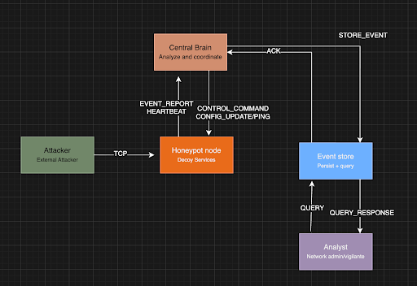

# Honeypot Detection Protocol

## Abstract
This network protocol allows for decoy network nodes to detect and record potential cyberattacks.

---

## Introduction
Cyberattacks are a growing problem for institutions that manage sensitive data, and the tools used to defend against them have not always kept pace. Platforms that millions of people rely on have been breached in recent years, and in many cases the attack went undetected until significant damage was done. Simply watching network logs is no longer enough. Administrators need systems that actively draw out attackers and gather intelligence on them in real time. Our project builds exactly that: a distributed honeypot system that uses decoy network nodes to simulate vulnerable services, lure in suspicious actors, and capture their behavior for analysis. 

---

## Architecture

The system is composed of three independently running components:

| Component | Role |
|---|---|
| **Honeypot Node** | Simulates vulnerable services (SSH, FTP, HTTP) to attract and observe attackers |
| **Central Brain** | Classifies attack behavior, coordinates node responses, and routes events to storage |
| **Event Store** | Persists classified events and node status data, exposes a query interface for analysts |





---

## Protocol

All components communicate exclusively over TCP using HDP, a custom JSON-based messaging protocol. The protocol is designed for internal use only and is never exposed to the network being monitored.

See the full message specification in [`PROTOCOL.md`](PROTOCOL.md).

---


## Running

### Prerequisites

- Java (JDK 8+)
- Python 3
- tmux (`brew install tmux` on macOS)

### Quick Start

```bash
./run.sh
```

This compiles the honeypot node and launches all four components (Attacker simulator, Honeypot Node, Central Brain, Event Store) in a 2×2 tmux layout. Each pane stays open after its process exits so you can read the output.

### Manual Start

Start each component in its own terminal in this order:

```bash
# 1. Event Store
cd event-store && python3 event_store.py 127.0.0.1 9001

# 2. Central Brain
cd central-brain && python3 central_brain.py

# 3. Honeypot Node (compile first)
cd honeypot-node
javac -cp lib/gson-2.13.1.jar HoneypotNode.java
java -cp .:lib/gson-2.13.1.jar HoneypotNode localhost 9000 2222 2121 8080

# 4. Attacker simulator
cd tests && python3 test.py
```

Ports used: Central Brain listens on **9000**, Event Store on **9001**. Honeypot Node exposes fake SSH on **2222**, FTP on **2121**, and HTTP on **8080**.

---

## Further Reading
[Protocol Specification](PROTOCOL.md)  
[Project Proposal](PROPOSAL.md)

---

## Status of This Memo  
---

## Copyright Notice
---


## Tech Stack


---

## Team

- Anthony Covello
- Francis Dinh
- Eli Gold